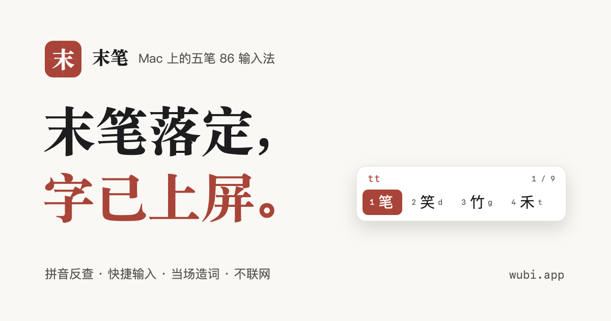

# 末笔

末笔（Mobi）是一款只做五笔 86 的 macOS 输入法，用 Swift 和 InputMethodKit 写成。不联网，没有账号，所有记录都留在你自己的电脑上。

仓库里还有它的官网（`site/`），官网上有一个网页版，可以不安装先试打：<https://wubi.app/#try>

## 功能

- **五笔 86**：四码唯一自动上屏，第五码顶字上屏，候选旁边提示剩余编码。
- **拼音反查**：按 `z` 再打拼音，候选会带上五笔编码；也可以打开「五笔拼音混输」，不按前缀键直接打拼音。
- **快捷输入**：`/rq` 日期、`/sj` 时间、`/dx1280` 大写数字、`/fh` 常用符号。
- **当场造词**：打编码时按 `Tab`（空码或最后一页时 `=` 也行），照常把词打出来，回车保存。编码按五笔词组规则自动算出，比如「迭代」存为 `rwwa`。
- **调频**：常选的字词往前排，可以关掉，让候选位置固定不动。
- **中文标点**：引号自动配对，数字后面的句点保持英文。
- **设置**：候选横排或竖排、每页个数、主题、中英切换键等。

## 键位

| 按键 | 作用 |
| --- | --- |
| 空格 | 上屏第一个候选 |
| `1` – `9` | 选择对应候选 |
| `;` `'` | 选择第二、第三个候选 |
| `-` `=` | 上一页、下一页 |
| `Tab` | 造词（空码或最后一页时 `=` 也行）；可在设置里改为翻页，`⇧Tab` 上一页 |
| 回车 | 上屏已输入的字母 |
| Esc | 取消输入 |
| Shift | 切换中英文 |
| `z` | 临时拼音 |
| `/` | 快捷输入 |

## 安装

从 [Releases](https://github.com/becoolme/wubi.app/releases) 下载 `Mobi-<版本>.pkg`，打开后按提示安装（会要求输入一次电脑密码）。末笔装在你自己的 `~/Library/Input Methods` 里，以后在后台自动更新，不用再输密码。然后到 系统设置 → 键盘 → 文字输入 → 输入法 → 编辑… → ＋ → 简体中文，添加「末笔」。列表里没有的话，注销再登录一次。

### 从源码构建

需要 macOS 13 或更高版本，以及 Xcode 命令行工具（Swift 5.9 以上）。

```bash
./scripts/build.sh
```

```bash
./scripts/install.sh
```

`build.sh` 生成 `build/Mobi.app`（临时签名），`install.sh` 把它复制到 `~/Library/Input Methods` 并重启输入法。

首次安装后，到 系统设置 → 键盘 → 文字输入 → 输入法 → 编辑… → ＋ → 简体中文，添加「末笔」。

## 你的数据

都在 `~/Library/Application Support/Mobi/`：

| 文件 | 内容 |
| --- | --- |
| `user.txt` | 自造词，每行 `编码 词`，可以直接编辑 |
| `usage.json` | 调频用的选词次数 |
| `wubi86.txt` | 可选。放一份自己的码表在这里，会代替内置码表 |

码表是纯文本，每行 `编码 词 [词频] 词 [词频] …`，也接受 Rime 的 `词 编码 [词频]` 写法。

## 开发

```
Sources/MobiCore   输入逻辑：码表、会话、标点、快捷输入、拼音索引，不依赖界面
Sources/Mobi       输入法本体：InputMethodKit 控制器、候选窗、设置窗口
Tests              MobiCore 的单元测试
Resources          Info.plist 和内置码表
scripts            构建、安装、图标与码表转换脚本
vendor/rime-wubi   码表来源及其许可证
site               官网（Astro）
```

### 发布

`scripts/release.sh` 用 Developer ID 签名，打出安装器 `build/Mobi-<版本>.pkg` 和自动更新用的 `build/Mobi-<版本>.zip`，交给 Apple 公证，再用 Sparkle 的私钥（钥匙串里的 `mobi` 账户）给 zip 签名，把这一版写进 `site/public/appcast.xml`。更新说明取自 `site/src/changelog.ts`，要先写好。公证凭据只需保存一次：

```bash
xcrun notarytool store-credentials mobi-notary --apple-id <Apple ID> --team-id 7U5UR46DGH
```

```bash
./scripts/release.sh
```

版本号在 `Resources/Info.plist`，官网的版本号在 `site/src/site.ts`，两处要一起改；`CFBundleVersion` 每次发布都要比上一版大，Sparkle 靠它判断新旧。打完包把 pkg 和 zip 传到 GitHub Release（`v<版本>`），再部署官网，已安装的末笔就会从 <https://wubi.app/appcast.xml> 看到新版。

运行测试：

```bash
swift test
```

重新从 rime-wubi 生成码表：

```bash
python3 scripts/import_rime.py vendor/rime-wubi/wubi86.dict.yaml Resources/wubi86.txt
```

重新生成官网的 favicon 和 banner（也就是本页顶部那张图）：

```bash
swift scripts/make_icons.swift --site site/public
```

### 官网

```bash
npm --prefix site install
```

```bash
npm --prefix site run dev
```

官网的统计用 Plausible，生产构建从 `site/.env.production` 读取 `PUBLIC_PLAUSIBLE_DOMAIN`（站点名）和 `PUBLIC_PLAUSIBLE_SRC`（脚本地址），两项有一项为空就不加统计脚本。

部署到 Cloudflare（Workers 静态资源，绑定 wubi.app）：

```bash
npm --prefix site run deploy
```

`site/src/ime/` 是输入逻辑的 TypeScript 移植，供页面上的试打区使用。它没有拼音、调频和设置，码表也去掉了浏览器通常显示不了的扩展区汉字。

## 联系

问题和建议可以开 [Issue](https://github.com/becoolme/wubi.app/issues)，也可以写信到 <hi@wubi.app>。

## 许可

代码以 [MIT](LICENSE) 许可发布。

五笔 86 码表来自 [rime-wubi](https://github.com/rime/rime-wubi)，仍以 LGPL-3.0 许可，见 [vendor/rime-wubi/LICENSE](vendor/rime-wubi/LICENSE)。
